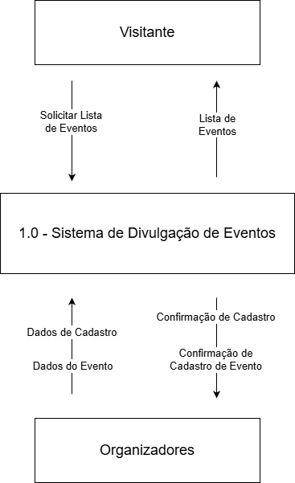
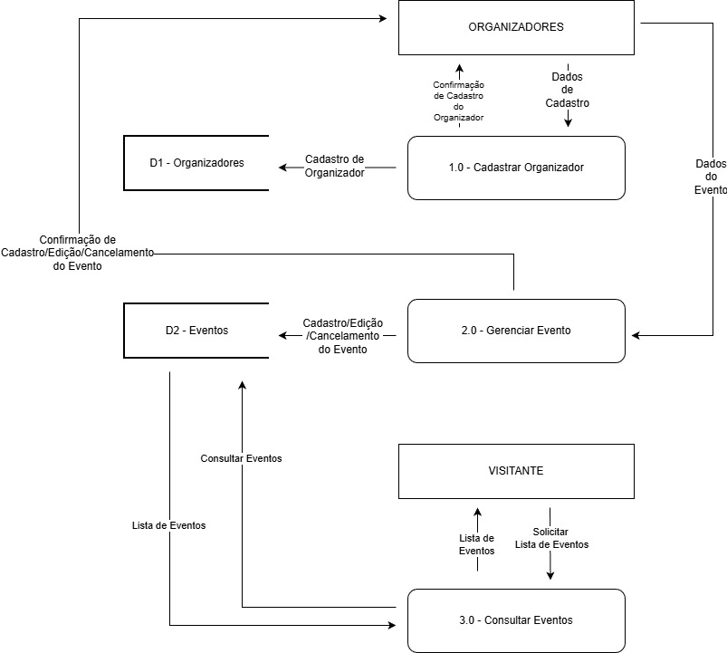

# 1 - Introdução 📘
Esta é a documentação do software para o "Sistema de Divulgação de Eventos" da prefeitura de Cabrobó do Sul. O objetivo desta documentação é explicar sobre o sistema, suas principais funcionalidades e como as informações circulam dentro dele, apresentando os usuários, requisitos de sistema e os diagramas necessários para representar o fluxo de dados da aplicação. 

# 2 - Descrição Funcional da Aplicação 🛠️
O Sistema de Divulgação de Eventos tem como objetivo disponibilizar aos usuários informações sobre eventos realizados na cidade de Cabrobó do Sul. Suas páginas principais são: Início, Eventos e Cadastro de Organizadores. 
 
Os visitantes podem acessar a página de eventos para visualizar todos os eventos cadastrados, e além disso, organizadores de eventos também terão a opção de realizar um cadastro para que possam registrar novos eventos, informando título, data, local, e uma breve descrição. 
 
O sistema busca organizar as informações de maneira prática e simples, tanto para cadastros quanto para consultas, além de estar preparado para futuras expansões. Ele também tem como objetivo ser acessível em diversos dispositivos, como celulares e computadores. 

# 3 - Atores do Sistema 👥

### 3.1 - Visitante 

O Visitante é qualquer usuário que tenha acesso ao sistema sem precisar de cadastro, ele poderá navegar entre as páginas: Início e Eventos, além de conseguir visualizar a lista completa de eventos já cadastrados.

### 3.2 - Organizadores

Os Organizadores são os usuários que realizam um cadastro no sistema para poder registrar novos eventos. E para isso os Organizadores precisam fornecer informações para registrarem os novos eventos, como título, data, local, e descrição do evento.

# 4 - Análise dos Requisitos 🔍

### 4.1 - Requisitos Funcionais (RF)

RF01 - O sistema deve mostrar as páginas: Início, Eventos, e Cadastro de Organizadores.
RF02 - O sistema deve permitir o cadastro de Organizadores a partir de um formulário de cadastro.
RF03 - O sistema deve validar os dados informados pelos Organizadores antes de concluir o cadastro.
RF04 - O sistema deve permitir que Organizadores registrem novos eventos caso os seguintes dados sejam informados: título, data, local e descrição.
RF05 - O sistema deve permitir que Organizadores editem eventos já cadastrados.
RF06 - O sistema deve permitir que Organizadores cancelem eventos já cadastrados.
RF07 - O sistema deve mostrar publicamente os eventos já cadastrados.
RF08 - O sistema deve permitir que visitantes visualizem os detalhes dos eventos.
RF09 - O sistema deve mostrar a lista completa de eventos na página "Eventos".  

### 4.2 - Requisitos Não Funcionais (RNF)

RNF01 - O sistema deve ter interface simples e de fácil entendimento para os usuários, tendo uma maneira intuitiva para navegar entre as páginas. 
RNF02 - O sistema deve ser acessível para usuários em dispositivos diferentes, como em celulares e computadores. 
RNF03 - O sistema deve ter uma boa performance, não demorando para carregar as páginas, mesmo que seja acessado em dispositivos diferentes. 
RNF04 - O sistema deve ser desenvolvido como uma aplicação web, que será aberta pelo navegador. 
RNF05 - O sistema deve armazenar de forma segura os dados de cadastro e de eventos informados pelos Organizadores. 
RNF06 - O sistema deve mostrar a lista de eventos publicamente sem a necessidade de um login.
RNF07 - O sistema deve ser desenvolvido de forma que permita futuras atualizações/expansões, como autenticação de usuário, e filtragem de eventos por categoria.   

# 5 - Regras de Negócio 🧠

RN01 - O cadastro de Organizadores deve ter todos os campos preenchidos para ser concluído. 
RN02 - O cadastro de um Evento deve ter todos os campos preenchidos para ser concluído. 
RN03 - Visitantes não podem alterar dados dos eventos.
RN04 - Apenas usuários com permissão (Organizadores) podem alterar dados de eventos, desde que sejam eventos cadastrados no seu usuário. 
RN05 - A data de um Evento deve ser válida, seguindo o formato (DD/MM/YYYY - Dia, Mês, Ano), não pode estar vazia, e não pode permitir uma data anterior à data de cadastro. 
RN06 - Eventos cancelados pelos Organizadores devem apresentar um status "Cancelado".

# 6 - Diagrama de Fluxo de Dados 🔄

O Diagrama de Fluxo de Dados (DFD) tem como objetivo representar o fluxo de informações do sistema, ou seja, mostrar como os dados entram, são processados, armazenados, e como saem do sistema. Nessa documentação teremos o DFD Nível 0, que mostra o sistema como um único processo e suas interações com o ambiente externo, e o DFD Nível 1, que detalha o processo principal em subprocessos, revelando o fluxo interno de informações. Confira a seguir:

## Diagrama de Fluxo de Dados – Nível 0

## Diagrama de Fluxo de Dados – Nível 1

# 7 - Dicionário de Dados 📚

## D1 – Organizadores 

Armazena os dados de usuários que se cadastram como organizador para fazer o cadastro de novos eventos.

| Campo           | Descrição                                     | Origem                           | Destino                  | Regras / Observações                    |
|-----------------|-----------------------------------------------|----------------------------------|--------------------------|-----------------------------------------|
| id_organizador  | Identificador único do organizador            | Processo "Cadastrar Organizador" | Depósito "Organizadores" | Deve ser único                          |
| nome            | Nome completo do organizador                  | Processo "Cadastrar Organizador" | Depósito "Organizadores" | Obrigatório                             |
| email           | E-mail informado pelo organizador no cadastro | Processo "Cadastrar Organizador" | Depósito "Organizadores" | Deve ser válido e único                 |
| senha           | Senha informada no cadastro                   | Processo "Cadastrar Organizador" | Depósito "Organizadores" | Armazenado de forma segura              |
| telefone        | Telefone de contato                           | Processo "Cadastrar Organizador" | Depósito "Organizadores" | Obrigatório                             |

## D2 - Eventos
Armazena os dados de todos os eventos cadastrados pelos organizadores. 

| Campo           | Descrição                                                                | Origem                      | Destino            | Regras / Observações                                          |
|-----------------|--------------------------------------------------------------------------|-----------------------------|--------------------|---------------------------------------------------------------|
| id_evento       | Identificador único do evento                                            | Processo "Gerenciar Evento" | Depósito "Eventos" | Deve ser único                                                |
| id_organizador  | Campo que faz referência ao organizador responsável pelo evento          | Processo "Gerenciar Evento" | Depósito "Eventos" | Campo relacionado ao id único do organizador                  |
| titulo          | Nome do evento                                                           | Processo "Gerenciar Evento" | Depósito "Eventos" | Obrigatório                                                   |
| descricao       | Descrição do evento                                                      | Processo "Gerenciar Evento" | Depósito "Eventos" | Obrigatório                                                   |
| data_evento     | Data do evento                                                           | Processo "Gerenciar Evento" | Depósito "Eventos" | Obrigatório, não pode ser anterior à data atual (de cadastro) |
| data_cadastro   | Data em que o evento foi cadastrado no sistema                           | Processo "Gerenciar Evento" | Depósito "Eventos" | Gerada automaticamente pelo sistema                           |
| local           | Local onde o evento ocorrerá                                             | Processo "Gerenciar Evento" | Depósito "Eventos" | Obrigatório                                                   |
| status          | Armazena o status do evento (Ativo/Cancelado)                            | Processo "Gerenciar Evento" | Depósito "Eventos" | "Ativo" ou "Cancelado"                                        |
